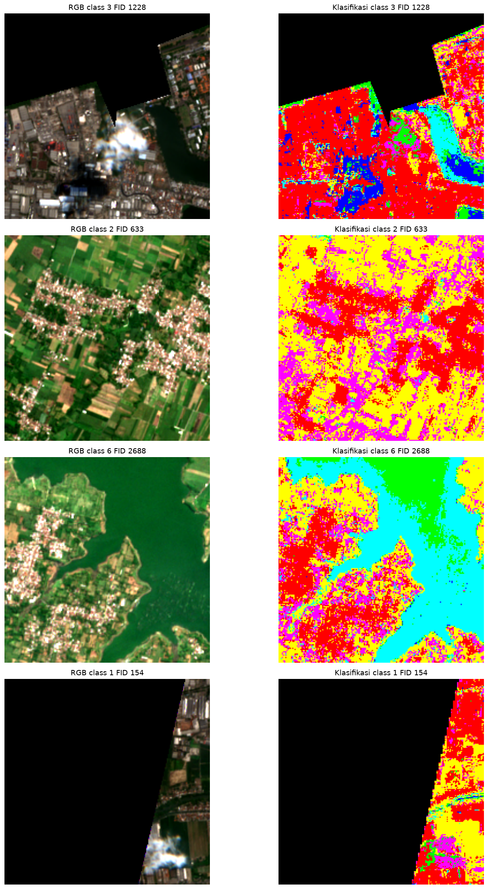

# Peta Tutupan Lahan Jawa Timur

Proyek ini mengolah citra **Sentinel-2** menjadi klasifikasi enam jenis
penutup/penggunaan lahan di Jawa Timur. Hasil analisis disajikan sebagai peta,
dashboard interaktif, dan laporan tahapan kerja.

**Coba hasilnya:** [Dashboard Streamlit](https://psd-klasifikasi-lahan-main-d32m2apyfjy9jndulj9eab.streamlit.app/) ·
[Baca laporan proyek](https://rafie110905.github.io/PSD-Klasifikasi-Lahan-main/intro.html)



## Wilayah dan kelas

Pemetaan mencakup Jawa Timur. Setiap piksel valid diprediksi ke salah satu
kelas berikut:

| Kode | Kelas |
|---:|---|
| 1 | Sawah |
| 2 | Bangunan / permukiman |
| 3 | Mangrove |
| 4 | Lahan hijau |
| 5 | Laut |
| 6 | Danau |

Model menggunakan enam kanal Sentinel-2 (`B02`, `B03`, `B04`, `B08`, `B11`,
`B12`) beserta indeks spektral **NDVI**, **NDWI**, dan **NDBI**. Sampel
berlabel dibagi menurut poligon, sehingga piksel dari poligon yang sama tidak
tersebar ke data latih dan uji sekaligus.

## Cara analisis

Notebook proyek mengikuti alur dari pemahaman masalah dan data, prapemrosesan,
pemodelan, evaluasi, hingga WebGIS. Lima algoritma dibandingkan dalam dua
representasi data: fitur per piksel dan ringkasan rata-rata per poligon.
Evaluasi memakai pemisahan kelompok poligon dan `StratifiedGroupKFold`;
Macro-F1, confusion matrix, serta hasil validasi silang tersedia dalam
artefak proyek.

Random Forest digunakan untuk menghasilkan peta akhir karena waktu
inferensinya lebih praktis. SVM per piksel memiliki skor validasi silang
tertinggi pada eksperimen ini, tetapi proses prediksinya jauh lebih lambat.
Perbedaan spektral yang tumpang tindih—misalnya sawah dengan lahan hijau—juga
membatasi ketepatan pemisahan kelas. Rincian hasil dan batasan dibahas di
[laporan Jupyter Book](https://rafie110905.github.io/PSD-Klasifikasi-Lahan-main/intro.html).

## Menjalankan dashboard

Gunakan Python 3.11 atau yang lebih baru:

```bash
pip install -r requirements.txt
streamlit run app.py
```

Dashboard membaca tabel evaluasi, gambar, dan model dari folder `outputs/`,
serta batas wilayah dari `data/`. Beberapa raster dan model berukuran besar
tidak disimpan di GitHub; dashboard menggunakan model SVM yang tersedia di
repo, sementara peta yang ditampilkan merupakan hasil klasifikasi yang sudah
disiapkan.

## Isi repository

```text
app.py                 Dashboard Streamlit
data/                  Batas wilayah dan sampel
notebooks/             Notebook tahapan analisis
outputs/figures/       Peta dan visualisasi
outputs/models/        Model klasifikasi
outputs/tables/        Data latih/uji dan metrik
intro.md               Halaman awal laporan
_toc.yml               Daftar isi laporan
_config.yml            Konfigurasi Jupyter Book
deployment.md          Catatan deployment
```

Laporan daring dibangun dari sumber Jupyter Book dan diterbitkan melalui
GitHub Actions: [buka laporan](https://rafie110905.github.io/PSD-Klasifikasi-Lahan-main/intro.html).
