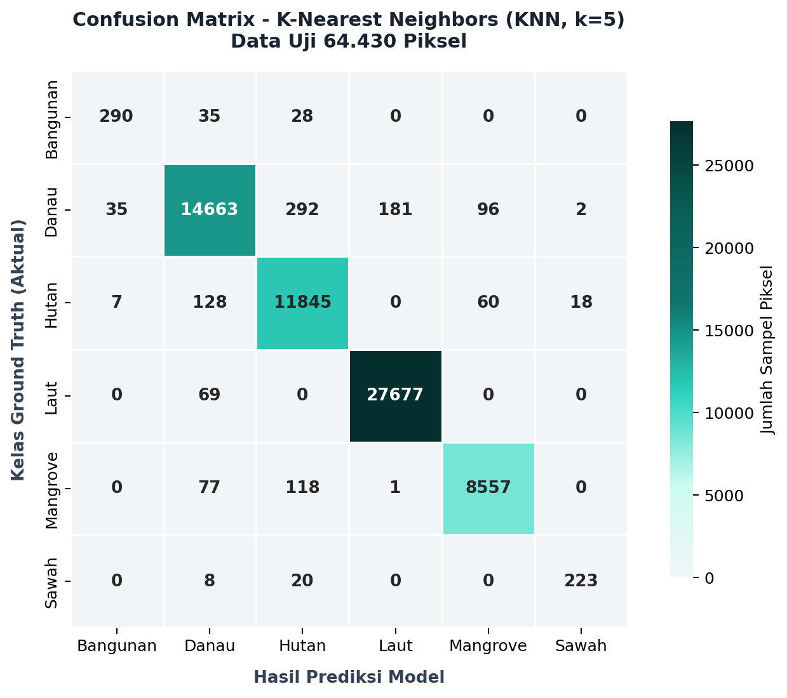
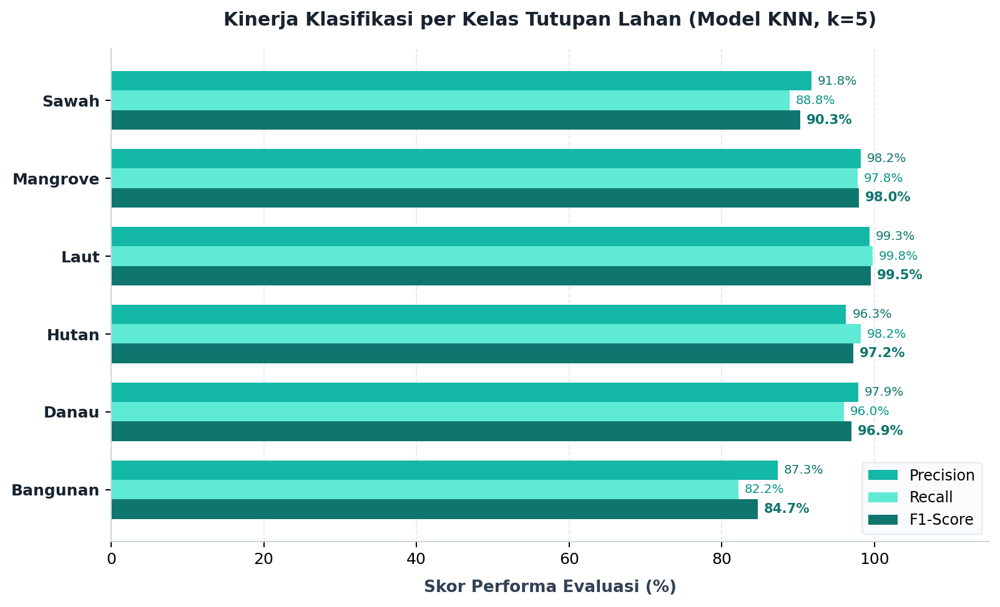

# Klasifikasi Spasial Tutupan Lahan Jawa Timur

## K-Nearest Neighbors dan Sentinel-2A

Laporan ini menjelaskan alur klasifikasi tutupan lahan Provinsi Jawa Timur
menggunakan citra **Sentinel-2A Level-2A** dan algoritma **K-Nearest Neighbors
(KNN)**. Struktur laporan mengikuti tahapan pemahaman masalah, pengumpulan
data, prapemrosesan, pemodelan, evaluasi, dan penyajian hasil spasial.

> **Aplikasi Streamlit:** dashboard Streamlit dalam repository ini tetap
> dipertahankan dan belum disinkronkan dengan aset KNN pada laporan. Peta KNN
> yang tersedia adalah keluaran HTML statis dari sumber proyek, bukan halaman
> Streamlit yang baru.

## Ringkasan proyek

| Komponen | Keterangan |
|---|---|
| Wilayah kajian | Provinsi Jawa Timur |
| Sumber citra | Sentinel-2A Level-2A, BOA surface reflectance |
| Akuisisi | CDSE openEO, dengan penyaringan awan memakai SCL |
| Dataset sampel | 322.146 piksel, 19 kolom, 274 poligon |
| Kelas | Sawah, Bangunan, Hutan, Danau, Laut, Mangrove |
| Fitur model | Lima band optik dan empat indeks spektral |
| Algoritma | KNN, 5 tetangga, Euclidean, uniform voting |
| Hasil data uji | Akurasi 98,18%; macro-F1 0,944; weighted-F1 0,982 |
| Hasil evaluasi poligon | 259 dari 268 poligon benar (96,6%) |

Sumber dataset dan hasil evaluasi tersedia di
[folder referensi KNN di GitHub](https://github.com/Rafie110905/PSD-Klasifikasi-Lahan-main/tree/main/data/knn_pdf_reference).
Angka evaluasi di halaman ini telah diperiksa terhadap CSV hasil yang tersedia.

## Lingkungan dan kebutuhan pustaka

Pustaka yang disebut dalam dokumentasi proyek meliputi:

```bash
pip install openeo geopandas rasterio shapely scikit-learn pandas numpy folium matplotlib seaborn pillow
```

Daftar ini merangkum kebutuhan alur crawling dan pemetaan. Dashboard yang saat
ini ada di repo memiliki `requirements.txt` tersendiri; jangan mengganti
lingkungannya dengan daftar di atas tanpa menyelaraskan kode aplikasi.

## 1. Business Understanding

### 1.1 Latar belakang

Tutupan lahan dapat dipetakan untuk membantu analisis lingkungan, pemantauan
ekosistem, perencanaan wilayah, dan ketahanan pangan. Jawa Timur mencakup
lanskap yang beragam, mulai dari area pertanian dan perkotaan hingga hutan,
badan air, pesisir, dan mangrove.

Pemetaan manual dari citra dapat memakan waktu dan rentan terhadap perbedaan
interpretasi. Citra multispektral dan klasifikasi berbasis machine learning
menyediakan cara untuk mengelompokkan piksel secara konsisten berdasarkan
pantulan spektralnya.

### 1.2 Tujuan

1. Mengklasifikasikan citra ke dalam enam kelas tutupan lahan.
2. Menggunakan fitur spektral Sentinel-2A yang dilengkapi indeks vegetasi,
   air, dan kawasan terbangun.
3. Mengevaluasi prediksi pada tingkat piksel dan merangkum hasilnya pada
   tingkat poligon.
4. Menyediakan visualisasi peta untuk memeriksa hasil klasifikasi secara
   spasial.

### 1.3 Definisi kelas operasional

| Label | Kelas | Gambaran umum |
|---:|---|---|
| 1 | Sawah | Petak pertanian padi, termasuk kondisi tergenang atau vegetatif |
| 2 | Bangunan | Permukiman, gedung, jalan, dan permukaan terbangun |
| 3 | Hutan | Kanopi vegetasi rapat dan lahan hijau |
| 4 | Danau | Waduk, telaga, dan badan air tawar pedalaman |
| 5 | Laut | Perairan pesisir dan laut terbuka |
| 6 | Mangrove | Vegetasi bakau di pesisir dan muara |

Definisi ini merupakan label operasional sampel dalam proyek, bukan pemetaan
resmi seluruh kategori penutup lahan.

## 2. Data Understanding

### 2.1 Data sampel

Dataset `dataset.csv` yang tersedia memiliki **322.146 baris dan 19 kolom**.
Satu baris mewakili satu piksel sampel, dengan atribut label, identitas
poligon, koordinat, nilai band, dan indeks spektral. Terdapat **274 poligon
sampel**.

Enam berkas ZIP poligon kelas dan batas provinsi tersedia di
[folder referensi KNN di GitHub](https://github.com/Rafie110905/PSD-Klasifikasi-Lahan-main/tree/main/data/knn_pdf_reference).
Raster regional `jatim_250m.tif` dari sumber proyek juga disertakan di folder
referensi.

### 2.2 Band Sentinel-2A yang digunakan

| Band | Nama | Panjang gelombang nominal | Kegunaan umum |
|---|---|---:|---|
| B02 | Blue | 490 nm | Pantulan spektrum biru dan karakteristik air |
| B03 | Green | 560 nm | Pantulan spektrum hijau dan respons vegetasi |
| B04 | Red | 665 nm | Serapan klorofil; membantu membedakan vegetasi |
| B08 | Near Infrared (NIR) | 842 nm | Respons vegetasi dan pemisahan badan air |
| B11 | Short-Wave Infrared (SWIR) | 1.610 nm | Kelembapan permukaan dan material terbangun |

B11 memiliki resolusi asli 20 m dan disesuaikan ke grid 10 m pada alur yang
dijelaskan di laporan.

### 2.3 Indeks spektral

Indeks dihitung dari band terkait dengan konstanta kecil `epsilon` untuk
menghindari pembagian nol.

| Indeks | Formula | Interpretasi umum |
|---|---|---|
| NDVI | `(B08 - B04) / (B08 + B04 + epsilon)` | Kondisi/kehijauan vegetasi |
| NDWI | `(B03 - B08) / (B03 + B08 + epsilon)` | Badan air permukaan |
| MNDWI | `(B03 - B11) / (B03 + B11 + epsilon)` | Deteksi air dengan kontribusi SWIR |
| NDBI | `(B11 - B08) / (B11 + B08 + epsilon)` | Permukaan terbangun |

### 2.4 Akuisisi dan penyaringan citra

Alur laporan menggunakan Copernicus Data Space Ecosystem (CDSE) melalui
openEO. Sampel poligon dibaca sebagai vektor, diseragamkan ke WGS84, lalu
digunakan untuk menentukan area permintaan citra. Area dibagi ke tile agar
permintaan batch dapat dikelola.

Scene Classification Layer (SCL) dipakai untuk menyingkirkan piksel awan,
cirrus, dan bayangan. Nilai spektral yang lolos digunakan untuk membentuk
komposit dan mengekstrak piksel sampel. Setiap rekaman dataset tetap
menyimpan identitas poligon asalnya.

### 2.5 Eksplorasi awal

Eksplorasi dalam laporan memeriksa jumlah piksel per kelas dan sebaran NDVI.
Secara umum, vegetasi rapat diharapkan menunjukkan respons NIR/NDVI yang
berbeda dari badan air dan permukaan terbangun. Namun, kedekatan spektral
antar kelas tetap dapat menyebabkan kekeliruan, sehingga evaluasi diperlukan.

## 3. Data Preprocessing

### 3.1 Pemilihan fitur dan pembagian data

Model menggunakan sembilan fitur: **B02, B03, B04, B08, B11, NDVI, NDWI,
MNDWI, dan NDBI**. Pembagian data dilakukan secara stratified pada tingkat
baris piksel dengan rasio 80:20.

| Bagian | Jumlah piksel |
|---|---:|
| Data latih | 257.716 |
| Data uji | 64.430 |
| Total | 322.146 |

### 3.2 Standardisasi

Karena KNN menghitung jarak antarsampel, fitur perlu berada pada skala yang
sebanding. `StandardScaler` menstandardisasi fitur menggunakan rerata dan
simpangan baku data latih, lalu transformasi yang sama diterapkan ke data uji.

### 3.3 Batasan split piksel

Pemisahan pada laporan dilakukan per piksel, bukan dengan menahan semua
piksel dari poligon tertentu sebagai data uji. Dengan demikian, piksel dari
poligon yang sama berpotensi ada di bagian latih dan uji. Skor yang dilaporkan
harus dipahami sesuai rancangan split tersebut; ia bukan estimasi langsung
performa pada wilayah geografis baru yang sepenuhnya terpisah.

## 4. Modeling

### 4.1 K-Nearest Neighbors

KNN menentukan kelas sampel baru berdasarkan kelas mayoritas dari tetangga
terdekat di ruang fitur. Konfigurasi yang digunakan dalam laporan:

| Parameter | Nilai |
|---|---|
| Jumlah tetangga (`n_neighbors`) | 5 |
| Metrik jarak | Euclidean |
| Bobot tetangga | Uniform |
| Prapemrosesan fitur | `StandardScaler` |

Secara ringkas, tiap piksel direpresentasikan sebagai vektor sembilan fitur.
Setelah fitur distandardisasi, model mencari lima sampel latih terdekat dan
menggunakan voting untuk menentukan label.

### 4.2 Batas reproduksibilitas

Dataset dan hasil evaluasi tersedia dalam folder referensi, tetapi model KNN
terlatih dan pipeline training yang menghasilkan angka PDF tidak tersedia
sebagai berkas terpisah. Notebook sumber klasifikasi yang ditemukan di repo
asal membahas eksperimen Random Forest, sehingga tidak diperlakukan sebagai
implementasi KNN. Oleh sebab itu, angka di bawah adalah hasil yang
terverifikasi dari artefak evaluasi, bukan hasil training ulang di repo ini.

## 5. Evaluation

### 5.1 Metrik data uji

CSV confusion matrix berisi 64.430 observasi. Dari matriks tersebut, akurasi
terhitung sekitar **98,176%**, sesuai nilai **98,18%** setelah pembulatan.

| Metrik | Hasil |
|---|---:|
| Accuracy | 98,18% |
| Macro-F1 | 0,944 |
| Weighted-F1 | 0,982 |
| Jumlah sampel uji | 64.430 |



### 5.2 Kinerja per kelas

| Kelas | Precision | Recall | F1-score | Support |
|---|---:|---:|---:|---:|
| Bangunan | 0,873 | 0,822 | 0,847 | 353 |
| Danau | 0,979 | 0,960 | 0,969 | 15.269 |
| Hutan | 0,963 | 0,982 | 0,972 | 12.058 |
| Laut | 0,993 | 0,998 | 0,995 | 27.746 |
| Mangrove | 0,982 | 0,978 | 0,980 | 8.753 |
| Sawah | 0,918 | 0,888 | 0,903 | 251 |



Laut memiliki F1-score tertinggi pada tabel. Kebingungan yang terlihat pada
confusion matrix antara lain Danau yang sesekali diprediksi sebagai Laut atau
Hutan. Kelas Bangunan dan Sawah memiliki support uji lebih kecil daripada
kelas lain, sehingga jumlah tersebut perlu ikut dipertimbangkan saat membaca
skor rata-rata.

### 5.3 Evaluasi tingkat poligon

Prediksi piksel diringkas per poligon menggunakan voting mayoritas. Berkas
`prediksi_data_uji.csv` berisi 268 poligon uji:

| Status | Jumlah | Persentase |
|---|---:|---:|
| Benar | 259 | 96,6% |
| Salah | 9 | 3,4% |

### 5.4 Peta dan pemeriksaan spasial

Peta interaktif KNN hasil sumber tersedia sebagai berkas HTML mandiri:

[Buka peta klasifikasi KNN Jawa Timur](report_assets/hasil_klasifikasi_knn.html)

Peta ini adalah hasil yang telah diproses sebelumnya. Peta tersebut tidak
dihasilkan ulang oleh dashboard Streamlit proyek ini.

## 6. Deployment dan cara menjalankan

Dashboard Streamlit yang ada di repo ini tetap menggunakan kode serta aset
sebelumnya. Sesuai permintaan, dashboard tidak diubah pada penyelarasan
laporan ini. Untuk menjalankan dashboard tersebut:

```bash
pip install -r requirements.txt
streamlit run app.py
```

Folder `data/knn_pdf_reference/` menyimpan dataset, raster, batas sampel, dan
artefak hasil KNN dari repository sumber. Ia dipisahkan dari `outputs/` agar
tidak menimpa aset yang dipakai dashboard saat ini.

## Kesimpulan

Laporan sumber menunjukkan bahwa KNN dengan sembilan fitur spektral mencapai
akurasi piksel 98,18% dan macro-F1 0,944 pada split uji yang dilaporkan.
Evaluasi mayoritas per poligon mencatat 259 dari 268 poligon benar. Hasil
tersebut menunjukkan pemisahan yang kuat pada data uji yang tersedia, dengan
catatan bahwa split dilakukan per piksel dan bukan holdout geografis per
poligon.

### Sumber dan provenance

Dataset serta artefak evaluasi diambil dari
[`itsaalii/PSD`](https://github.com/itsaalii/PSD), commit
[`687183bddc9f78a89ef701642bde9a634a80f63c`](https://github.com/itsaalii/PSD/tree/687183bddc9f78a89ef701642bde9a634a80f63c).
Narasi laporan ini disusun ulang dari PDF proyek dan artefak yang tersedia;
kode sumber laporan tidak disalin verbatim.
